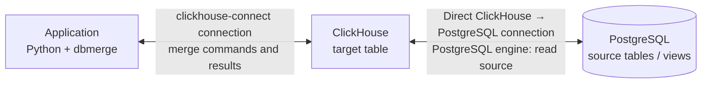

# ClickHouse

This document describes using ClickHouse with `dbmerge`: connecting, preparing the target table, running a merge, and reading the result. See [DOCUMENTATION.md](DOCUMENTATION.md) for the full API and [COMPATIBILITY.md](COMPATIBILITY.md) for tested versions and drivers.

## How merge works

`dbmerge` synchronizes source data with a ClickHouse target table. The source can be data in Python or a table or view accessible to ClickHouse. Data is loaded into a staging table, then ClickHouse runs bulk queries to find new, changed, and—if deletion is enabled—missing rows.

Use the `clickhouse-connect` driver: either the SQLAlchemy URL `clickhousedb://` or a `clickhouse_connect` client. Install the optional dependency with `pip install 'dbmerge[clickhouse]'`.

```python
from sqlalchemy import create_engine
from dbmerge import dbmerge

engine = create_engine("clickhousedb://default:@localhost:8123/default")

rows = [
    {"id": 1, "name": "item A"},
    {"id": 2, "name": "item B"},
]

with dbmerge(
    engine=engine,
    data=rows,
    table_name="Products",
    schema="default",
    key=["id"],
) as merge:
    result = merge.exec()

print(result.inserted_row_count, result.updated_row_count)
```

## Why use merge instead of a blind `INSERT`

A plain `INSERT` appends the supplied rows without matching them against rows already stored. `dbmerge` matches source and target rows by key and writes new versions for new or changed rows.

Key capabilities:

1. **Handles rows missing from the source.** Unlike a blind `INSERT`, `dbmerge` can find target rows that are no longer present in the source and either delete them (`delete_mode="delete"`) or mark them (`delete_mode="mark"`). When merging a partial source, scope the operation with `delete_condition`.
2. **Tracks first insertion and last merge separately.** `inserted_on_field` is set when a row is first inserted and preserved on later changes; in ClickHouse its value is copied from the previous row version. `merged_on_field` is refreshed when a row is inserted, changed, or marked. These fields distinguish when a row first appeared from when it was last processed by a merge.
3. **Reports the outcome.** `result` provides counts of processed, inserted, updated, and deleted or marked rows, along with phase durations. In ClickHouse, an updated row is physically written as a new version with `INSERT` but is counted in `updated_row_count`. With concurrent writes, `deleted_row_count` in `delete` mode is an estimate.
4. **Can prepare the target schema.** By default, `dbmerge` creates a missing target table and adds missing columns, inferring their types from the input data. Disable this with `can_create_table=False` and `can_create_columns=False` when schema changes are managed separately.

> **Important:** automatic table creation does not remove the requirement for a `ReplacingMergeTree` target with the appropriate `ORDER BY` key. See the requirements below.

## Reading from PostgreSQL through ClickHouse

One way to connect the systems is to attach PostgreSQL to ClickHouse as a database using the `PostgreSQL` engine. Configure the address and credentials when creating the database; the ClickHouse server must be able to reach PostgreSQL over the network. Run this once in ClickHouse:

```sql
CREATE DATABASE shop_pg
ENGINE = PostgreSQL('pg-host:5432', 'shop', 'reader', 'password', 'public');
```

The PostgreSQL table can then be used as a `dbmerge` source:

```python
from dbmerge import dbmerge

with dbmerge(
    engine=engine,                 # ClickHouse connection via clickhouse-connect
    source_table_name="facts",   # PostgreSQL table exposed in ClickHouse
    source_schema="shop_pg",     # attached ClickHouse database
    table_name="Facts",          # ClickHouse target table
    schema="target",
    key=["shop", "product", "day"],
    delete_mode="delete",
) as merge:
    result = merge.exec()
```

In this setup, the application running `dbmerge` connects to ClickHouse, and ClickHouse connects directly to PostgreSQL to read the source. PostgreSQL rows do not pass through the application.

### Architecture



> ClickHouse is the intermediary: `dbmerge` controls the operation through its ClickHouse connection, while the ClickHouse server is configured to connect directly to PostgreSQL.

## Target table requirements

- The target must use the `ReplacingMergeTree` family and be ordered (`ORDER BY`) by the merge key. Specify `key` explicitly, especially when creating the target from a database-engine source, which has no sorting key to infer.

> **Note:** In `ReplacingMergeTree`, an update is written as a new row version. Older versions may remain visible until ClickHouse merges the parts; use `FINAL`, for example `SELECT * FROM target.Facts FINAL`, to read the current state.

> **Note:** Key columns cannot be `Nullable`, and key values cannot be `NULL`. A source `NULL` cannot be loaded into a non-`Nullable` target column. The staging table does not reject duplicate source keys; deduplicate the source if it matters which value is retained.

## Staging and loading

The staging table is used for bulk loading and comparison with the target. It is normally temporary and visible only in the ClickHouse session; `temp_schema` does not apply in that case.

> **Note:** With `delete_mode="delete"`, staging is a regular table because a `DELETE` mutation cannot read a temporary table. Such a staging table may remain if the process terminates unexpectedly.

ClickHouse loads data into staging in batches.

> **Note:** The default `chunk_size` is `1_000_000`. Very small batches can create many small table parts; choose a size appropriate for the data volume and available memory.

## Filtering and deletions

Use `source_condition` for a partial sync. Set `delete_condition` as needed to scope rows affected by deletion.

> **Important:** With `delete_mode="delete"` or `delete_mode="mark"`, target rows absent from the current source are considered missing. If the source contains only a subset, deletion or marking without a matching `delete_condition` may affect rows outside that subset. An unscoped delete with an empty source can clear the target table.

> **Note for PostgreSQL sources:** ClickHouse may push only part of a filter down to PostgreSQL and apply the rest after reading. To select changed rows by key, `dbmerge` can evaluate a single-column `IN` subquery first and substitute its keys into the condition. Correlated subqueries and multi-column `IN` conditions may be evaluated by ClickHouse. A `ReplacingMergeTree` source is read with `FINAL`. For PostgreSQL `timestamptz`, account for the time zones of both the PostgreSQL session and ClickHouse.

## Limitations

- Transactions are not supported in this ClickHouse workflow: each statement takes effect as soon as it runs. `commit_all_steps` does not make the merge atomic.
- Use `clickhouse-connect` (`clickhousedb://` or a `clickhouse_connect` client). `clickhouse-sqlalchemy` is not supported: it opens a new session for each statement, so the staging table would not persist between steps.

## Further reading

- [Full API documentation](DOCUMENTATION.md#clickhouse)
- [Compatibility and tested versions](COMPATIBILITY.md#clickhouse)