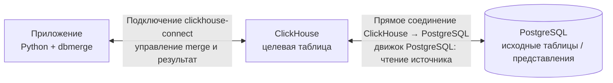

# Работа с ClickHouse

Этот документ описывает использование ClickHouse в `dbmerge`: подключение, подготовку целевой таблицы, выполнение merge и чтение результата. Подробные параметры API и общие правила `dbmerge` приведены в [DOCUMENTATION.md](DOCUMENTATION.md); проверенные версии и драйверы — в [COMPATIBILITY.md](COMPATIBILITY.md).

## Как работает merge

`dbmerge` реализует синхронизацию исходных данных с целевой таблицей ClickHouse. В качестве источника можно передать данные в Python или таблицу/представление, доступные самому ClickHouse. Данные загружаются в staging-таблицу, затем ClickHouse выполняет пакетные запросы для определения новых, изменённых и, если включено удаление, отсутствующих строк.

Для подключения используйте драйвер `clickhouse-connect`: SQLAlchemy URL `clickhousedb://` или клиент `clickhouse_connect`. Установить дополнительную зависимость можно командой `pip install 'dbmerge[clickhouse]'`.

```python
from sqlalchemy import create_engine
from dbmerge import dbmerge

engine = create_engine("clickhousedb://default:@localhost:8123/default")

rows = [
    {"id": 1, "name": "товар A"},
    {"id": 2, "name": "товар B"},
]

with dbmerge(
    engine=engine,
    data=rows,
    table_name="Products",
    schema="default",
    key=["id"],
) as merge:
    result = merge.exec()

print(result.inserted_row_count, result.updated_row_count)
```

## Чем merge лучше слепого `INSERT`

Обычный `INSERT` добавляет переданные строки, но сам по себе не сопоставляет их с уже сохранёнными. `dbmerge` сравнивает источник с целевой таблицей по ключу и записывает новые версии только для новых и изменившихся строк.

Основные возможности:

1. **Обрабатывает строки, пропавшие из источника.** В отличие от слепого `INSERT`, `dbmerge` может найти целевые строки, которых больше нет в источнике, и по настройке физически удалить их (`delete_mode="delete"`) или пометить (`delete_mode="mark"`). Для частичного источника область действия нужно ограничить через `delete_condition`.
2. **Различает время первой вставки и последнего изменения.** `inserted_on_field` задаётся при первой вставке и сохраняется при последующих изменениях; в ClickHouse его значение переносится из предыдущей версии строки. `merged_on_field` обновляется при вставке новой строки, изменении существующей или её пометке. Это позволяет видеть, когда запись появилась впервые и когда её в последний раз обработал merge.
3. **Возвращает статистику результата.** В `result` доступны количества обработанных, вставленных, изменённых и удалённых/помеченных строк, а также длительности этапов. В ClickHouse изменённая строка физически записывается как `INSERT` новой версии, но считается в `updated_row_count`. При конкурентных записях `deleted_row_count` в режиме `delete` является оценкой.
4. **Упрощает подготовку схемы.** По умолчанию `dbmerge` создаёт отсутствующую целевую таблицу и добавляет недостающие колонки, выводя типы из входных данных. Это можно отключить параметрами `can_create_table=False` и `can_create_columns=False`, если схемой управляют отдельно.

> **Важно:** автоматическое создание таблицы в ClickHouse не заменяет настройку `ReplacingMergeTree` и ключа `ORDER BY`. Целевая таблица должна соответствовать требованиям раздела выше.

## Вставка из PostgreSQL при связи с ClickHouse

Один из вариантов такой связи — подключить PostgreSQL в ClickHouse как базу данных с движком `PostgreSQL`. Учётные данные и адрес указываются при создании базы; ClickHouse должен иметь сетевой доступ к PostgreSQL. Например, выполнить в ClickHouse один раз:

```sql
CREATE DATABASE shop_pg
ENGINE = PostgreSQL('pg-host:5432', 'shop', 'reader', 'password', 'public');
```

Затем PostgreSQL-таблицу можно использовать как источник `dbmerge`:

```python
from dbmerge import dbmerge

with dbmerge(
    engine=engine,                 # соединение с ClickHouse через clickhouse-connect
    source_table_name="facts",   # таблица PostgreSQL, видимая в ClickHouse
    source_schema="shop_pg",     # подключённая база ClickHouse
    table_name="Facts",          # целевая таблица ClickHouse
    schema="target",
    key=["shop", "product", "day"],
    delete_mode="delete",
) as merge:
    result = merge.exec()
```

При таком способе приложение с `dbmerge` подключается к ClickHouse, а сам ClickHouse имеет отдельную связь с PostgreSQL и читает оттуда источник. Строки из PostgreSQL не проходят через приложение.

### Архитектура связи



> ClickHouse выступает посредником между источником и целевой таблицей: `dbmerge` управляет операцией через подключение к ClickHouse, а соединение ClickHouse с PostgreSQL настроено на стороне ClickHouse.

## Требования к целевой таблице

- Для merge требуется целевая таблица семейства `ReplacingMergeTree`, упорядоченная (`ORDER BY`) по ключу merge. Укажите `key` явно, особенно если таблица создаётся из источника database engine: у такого источника нет ключа сортировки, который можно автоматически использовать.

> **Примечание:** в `ReplacingMergeTree` изменение строки записывается как новая версия. Пока ClickHouse не сольёт части таблицы, при чтении могут быть видны и старые версии; чтобы получить актуальное состояние, используйте `FINAL`, например `SELECT * FROM target.Facts FINAL`.

> **Примечание:** колонки ключа должны быть не `Nullable`, и `NULL` в ключе не допускается. `NULL` из источника не загрузится в целевую колонку, объявленную не `Nullable`. Повторяющиеся ключи в источнике staging не отклоняет; устраните дубликаты заранее, если важно, какая запись останется.

## Staging и загрузка

Staging-таблица используется для пакетной загрузки и сравнения с целевой. Обычно она временная и видна только в сессии ClickHouse; `temp_schema` в этом случае не применяется.

> **Примечание:** при `delete_mode="delete"` staging создаётся как обычная таблица, поскольку мутация `DELETE` не может читать временную таблицу. Если процесс аварийно завершится, такая staging-таблица может остаться.

ClickHouse загружает данные в staging пакетно.

> **Примечание:** `chunk_size` по умолчанию равен `1_000_000`. Слишком маленькие пакеты могут создавать много мелких частей таблицы; подбирайте размер с учётом объёма данных и доступной памяти.

## Фильтрация и удаления

Для частичной синхронизации передавайте `source_condition`. При необходимости ограничить затрагиваемые при удалении строки укажите соответствующий `delete_condition`.

> **Важно:** при `delete_mode="delete"` или `delete_mode="mark"` строки целевой таблицы, которых нет в источнике текущего запуска, считаются отсутствующими. Если источник содержит только часть данных, без подходящего `delete_condition` удаление или пометка может затронуть строки за пределами этой части. Пустой источник при неограниченном удалении может очистить целевую таблицу.

> **Примечание для PostgreSQL-источника:** ClickHouse может передать PostgreSQL только часть условий фильтра, а остальные применить после чтения. Чтобы выбрать изменившиеся строки по ключам, `dbmerge` умеет выполнить подзапрос с `IN` для одного столбца и подставить найденные ключи в условие. Коррелированные подзапросы и `IN` по нескольким колонкам могут обрабатываться на стороне ClickHouse. Источник `ReplacingMergeTree` читается с `FINAL`. Для `timestamptz` учитывайте часовые пояса сессии PostgreSQL и ClickHouse.

## Ограничения

- ClickHouse не поддерживает транзакции в используемом сценарии: каждый запрос становится окончательным сразу после выполнения. `commit_all_steps` не даёт атомарности.
- Используйте `clickhouse-connect` (`clickhousedb://` или клиент `clickhouse_connect`). Драйвер `clickhouse-sqlalchemy` не поддерживается: он открывает новую сессию на каждый запрос, поэтому staging-таблица не сохраняется между шагами.

## Дополнительно

- [Полная документация API](DOCUMENTATION.md#clickhouse)
- [Совместимость и проверенные версии](COMPATIBILITY.md#clickhouse)