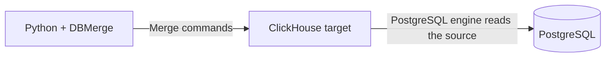

# Load PostgreSQL data into ClickHouse

Use this recipe when ClickHouse can connect directly to PostgreSQL. Python runs the merge through its ClickHouse connection; ClickHouse reads the source into staging without sending the rows through Python. Each run reads the source again; this is not continuous replication.



## 1. Attach the PostgreSQL database

The ClickHouse server must be able to reach PostgreSQL. Use a PostgreSQL account with read access to the source. In this example, the PostgreSQL database `shop` has a `public.facts` table with columns `shop`, `product`, `day`, and `qty`; `(shop, product, day)` uniquely identifies a row. Replace the connection values before running this once in ClickHouse:

```sql
CREATE DATABASE shop_pg
ENGINE = PostgreSQL('pg-host:5432', 'shop', 'reader', 'replace-me', 'public');

SELECT shop, product, day, qty FROM shop_pg.facts LIMIT 5;
```

## 2. Merge into ClickHouse

Install `dbmerge[clickhouse]`. Connect **only to ClickHouse** from Python. The example writes to `default.Facts` and leaves rows absent from the source untouched. DBMerge can create the target from the source column types. If you create it yourself, use `ReplacingMergeTree` with `ORDER BY (shop, product, day)` and non-nullable key columns.

```python
from sqlalchemy import create_engine
from dbmerge import DBMerge

engine = create_engine("clickhousedb://default:@localhost:8123/default")
with DBMerge(
    engine=engine,
    source_schema="shop_pg",
    source_table_name="facts",
    schema="default",
    table_name="Facts",
    key=["shop", "product", "day"],
) as merge:
    result = merge.exec()

print(result.inserted_row_count, result.updated_row_count)
```

`source_schema` is the attached **ClickHouse** database name (`shop_pg`), not the PostgreSQL schema (`public`). A view in the attached schema can also be used as the source. Read current target rows with `FINAL`:

```sql
SELECT shop, product, day, qty FROM default.Facts FINAL;
```

## 3. Choose what to refresh

- **Only new and changed rows:** keep `delete_mode='no'`. Use `source_condition` on `merge.source_table` to select changed rows if your source tracks them.
- **A complete month or shop:** follow the [scoped snapshot recipe](GUIDES.md#scoped-snapshot). Apply matching filters to `source_condition` and `delete_condition` before enabling deletion or marking.
- **The entire target:** follow the [full snapshot recipe](GUIDES.md#full-snapshot) only if the PostgreSQL source includes every row that should exist in the target.

ClickHouse can push simple comparisons into PostgreSQL, but it may apply more complex predicates after reading the source. For pushdown and PostgreSQL `timestamptz` details, see [Source tables on ClickHouse](DOCUMENTATION.md#source-tables-on-clickhouse).

[RU](POSTGRESQL_TO_CLICKHOUSE_RU.md)